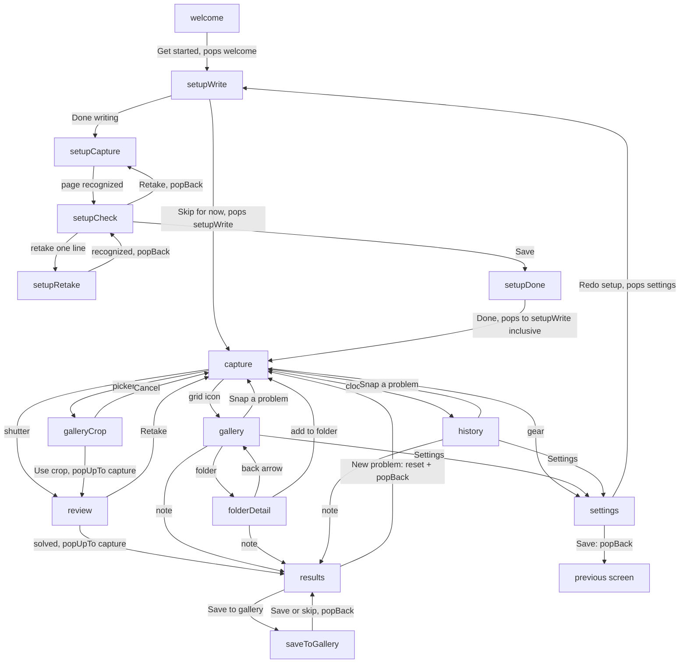

# ProofPad UX and service audit (2026-11-27)

An audit of ProofPad as if it were going to real users, not a class demo. **No code was changed.**

- App: commit `aa26fcb`, debug build, on a Pixel 7 (Android 16, API 37, system dark mode on).
- Backend: same commit, live Mathpix.
- Evidence tags: **[device]** means I did it on the Pixel and saw it; **[code]** means read from the source and not run; **[probe]** means run against the backend.
- Paths are relative to `android/app/src/main/java/com/mathnotes/solver/` for the app and `backend/` for the service.
- Estimates: **S** under half a day, **M** half a day to two days, **L** more than two days.

## Fix status (branch `ramani/dec2-blockers`)

The twelve "before Dec 2" items, in the order they were fixed. Each was checked on the Pixel 7
unless the last column says otherwise. Everything else in this document is still open.

| Item | Status | Commit | Checked |
|---|---|---|---|
| B6 one request can freeze the service | **Fixed.** Solve, verify and parsing run in killable worker processes with deadlines (10 s / 10 s / 5 s; the Mathpix call 20 s); LaTeX capped at 2000 characters and 24 levels; two server processes | `e9a14b2` | Live: the power-tower request returns 422 at 10 s while `/health` answers in milliseconds; a 200 KB input is refused at once. 12 new backend tests |
| B2 blank Review with no backend, B3 stale problem under a new photo | **Fixed.** Error note with Retry and the connection chip; the photo is kept and resent | `d74057e` | Airplane mode on: note shown. Off: resent on its own |
| B1 camera denied | **Fixed.** Notepad page with "Allow camera", then "Open settings" after the second denial; re-checked on resume | `6451c45` | Deny, deny again, Open settings, grant, return |
| C2 "page found · hold still" | **Fallback taken.** The line now says "hold still". Live page detection is not built and is logged in `README.md` under Known issues | `f4826c2` | Text on device |
| C15 16 KB compatibility dialog | **Fixed in the build.** OpenCV 4.12.0; all six arm64 libraries have 16 KB LOAD segments; the Pixel's package record went from `pageSizeCompat=4` to `0` | `cd03068` | **Not confirmed by a fresh install** (uninstalling was not possible in this session). Preprocessing still works with the new OpenCV; the on-device preprocessing test was not re-run |
| C4 no save feedback, C5 folder delete, part of B8 | **Fixed.** "Saved to <folder>" notice and button label; folder delete asks first and offers Undo for 5 s; press and hold a note to delete it, with Undo | `3149716` | Save, delete folder + Undo, delete note + Undo. No Room test was added for the restore (instrumented tests were not run) |
| C6 unsolved History items | **Fixed.** "not solved yet" page with "Solve it" and "Fix the reading" | `7b41c18` | Opened one and solved it from there |
| B5 PDF export can crash | **Fixed.** Written on a background thread with progress; error sheet with Retry | `54a5402` | Normal export to the share sheet; a forced write failure showed the sheet, Retry worked |
| B12 instrumented tests wipe the phone | **Guarded.** Connected test tasks refuse to run without `-PallowDeviceWipe` | `de1737e` | Gradle refuses without the flag (run against a non-existent device serial) |
| C10 controls that do nothing | **Fixed.** Removed; the folder bar now has Settings and "Snap a problem" | `3da23c4` | Folder bar on device |
| C3 raw error text, C14, the error half of C13 | **Fixed.** One plain-sentence mapping for every failure; wizard retake errors are now shown; the server no longer returns the recognizer's reply | `e1e2185`, `c1f6490` | A failed Check on device; a blank photo says "I couldn't find any writing in that photo" |
| P1 name, P2 Welcome | **Partly.** "ProofPad" everywhere; the tagline lists limits. The "NUMERO UNOS · ECE 454" footer is left for the team to decide. The pink strip is the notebook cover's elastic band, not an empty label, so it stays | `e6492ee` | Not re-walked (needs the Welcome screen) |
| Double-tap guards (from C12) | **Fixed** for shutter, Solve, Check my steps, Save and Export | `986ab04` | Three rapid taps gave one verify request and one photo |

**B4 (process death)** was fixed after PR #25: the capture in progress, the edited reading, the
steps, the result, the open folder and a pending picked photo are kept in the view model's
SavedStateHandle and restored; a recognition cut off mid-flight comes back as the Retry note; a
restart with nothing to restore goes to Capture, never a blank page. Checked on the Pixel by
killing the backgrounded process on Review (with an edit), on Results, and during recognition.
The handwriting wizard's own state is not covered.

**B9 (the keep-photo checkbox)** was fixed after that: saving with the box unticked deletes the
note's stored photo and the camera or picked original, and clears the note's photo. The sheet says
so before you save and hides the box for a note that has no photo. Checked on the Pixel: both files
were gone after the save, and a control save with the box ticked kept them.

**B10 (storage growth)** was fixed after that. A successful capture deletes its camera or picked
original at once (about 3.7 MB each on the Pixel). A clean-up runs at every start and from Settings
"Free up space now" (`data/StorageJanitor.kt`): originals from failed or abandoned captures, photos
and wizard thumbnails nothing points at, exported PDFs older than a day, and debug stages older
than a week. Photos that belong to a note are never touched. On the Pixel, "Free up space now" took
the app's photo storage from 10.3 MB to 0.8 MB with every note's photo intact. Unsolved captures
left in My notebook keep their photos until the note is deleted.

**B7 (default backend URL)** was fixed in code after that. With no address set, the app tries the
hosted service first (waiting up to a minute for a sleeping instance) and then the build's own
address; an address the user typed or scanned is used on its own and "Use the default solver"
clears it. The chip, sheet and Settings now say "solver" and no longer tell a first-time user that
"that URL" is unreachable. **It is not working end to end yet:** the hosted service requires the
app key, the debug build on the Pixel was made without one in `local.properties`, and so it was
refused (HTTP 401) and the app fell back to the build's LAN address. A build with the real
`PROOFPAD_API_KEY` is needed before a fresh install connects on its own.

**B8 (no way to delete)** is now complete: Settings has "Your data" with the counts and "Clear all
data", behind a dialog that says what will go and that it cannot be undone. It deletes every note,
folder and handwriting sample and every photo, thumbnail and exported PDF; settings stay. Checked on
the Pixel: Cancel deleted nothing; confirming left My notebook and the Gallery empty, no files, and
the solver address unchanged. (Single notes and folders were already deletable with Undo.)

**B11 (open, unmetered backend)** is **accepted as it is** (team decision, 2026-11-27): locking it
down would interfere with campus Wi-Fi. No rate limit, key or `/sessions` changes are planned. The
finding stays in the table below as a record of what the audit saw.

Nothing is left open from the "blocks a user" list.

**Request cancellation (from C12)** was added after that. Every request in flight can be stopped:
a Cancel button on Review while reading, solving or checking; Retake, New problem and the back
button cancel too; "Show me the full solution" becomes "tap to cancel" while it runs; the unsolved
page and the wizard's page capture have Cancel as well. The network call is aborted and a late
answer can no longer overwrite the next capture. Checked on the Pixel against a deliberately slow
stand-in server: cancelling a check kept the reading and steps, and in each case the phone had
closed the connection before the answer was ready. Not covered: the wizard's single-line retake
screen shows no progress or Cancel (it reads its busy state from the wrong view model, C13), and
the server keeps working on a cancelled request until its own deadline.

## How the device walk was done, and what it could not cover

- The walk started from a **fresh install**. My earlier `connectedDebugAndroidTest` run uninstalled the app when it finished and took the on-device notes with it (see B12). That made a true first run possible.
- Captures were fed through the gallery picker using today's saved photos. The camera path itself (shutter, flash, QR scan) was not exercised with a live scene.
- The activity is locked to portrait, so rotation cannot happen; process death was tested instead.
- Not run on the device, read from code only: the handwriting wizard's capture and retake screens, PDF export failure, low storage, a backend 500, a verify timeout, permanent camera denial, TalkBack.
- API 29 vs 33 storage: not applicable. Export writes to the app's cache and shares through a `FileProvider`; no storage permission is declared or needed.
- Notifications: the app posts none and requests no notification permission.

## Navigation graph (as built)

Start destination: `capture` only when both "welcome seen" and "setup complete" are set, otherwise `welcome` (`MainActivity.kt:45`). One activity, one activity-scoped `SolverViewModel`. There is no `BackHandler` anywhere, so system back is always the default pop.

### Compared with the intended flow

| Intended | As built | Gap |
|---|---|---|
| Welcome on first launch only | Welcome shows whenever setup is not complete, so quitting mid-wizard shows it again **[device]** | C1 |
| Setup wizard, then Capture as home | Yes | |
| Gallery, History, Settings from Capture's header | Yes (Settings is the gear in the bottom row) | |
| Review → Results → Save sheet → back to Capture | Save returns to **Results**, not Capture, with no confirmation **[device]** | C4 |
| Gallery → Folder → Note (Results read-only) → back | The note opens in the ordinary Results screen and is editable **[code]** | C9 |
| Settings → Redo setup / Handwriting samples / Backend | Yes | |

### Back button, screen by screen

| Screen | System back goes to | Notes |
|---|---|---|
| welcome | exits the app **[device]** | fine |
| setupWrite | exits the app; relaunch shows Welcome again **[device]** | C1 |
| setupCapture, setupCheck, setupRetake, setupDone | previous wizard screen **[code]** | |
| capture | exits the app; relaunch resumes on Capture **[device]** | fine |
| galleryCrop | capture **[code]** | |
| review | capture **[code]** | never returns to a stale Review |
| results (new problem) | capture, state left in place **[device]** | the unsaved result is dropped with no prompt; it is still in History |
| results (opened note) | gallery, folder or history **[device]** | fine |
| saveToGallery | results **[code]** | |
| gallery, history | capture **[device]** | |
| folderDetail | gallery **[code]** | |
| settings | previous screen, **discarding** a typed URL **[code]** | C7 |

- "New problem" resets all of `SolverUiState` **[code]**. It does not cancel a request in flight (C12).
- A new capture always clears the previous result before navigating, so Review never jumps to a stale Results **[code]**. It does not clear the previous LaTeX and steps (B3).

### Dead ends and missing routes

- **Results → Gallery**: none. After saving you are on Results; reaching the Gallery takes New problem → Capture → grid icon.
- **History → Gallery** and **Gallery → History**: none; both go through Capture.
- **Folder → Settings**: none. The folder screen's bottom bar holds two permanently disabled buttons (C10).
- **Folder → Capture with the folder preselected**: the "add to Calc II" card only pops to Capture; nothing carries the folder (C8).
- **Settings**: the only on-screen exit is "Save", which refuses a blank or invalid URL (C7).
- **Camera denied**: no route to grant it (B1).
- **Review after a failed recognition**: blank page, one working button (B2).

---

## Blocks a user

| # | Where | Today | Should | Est. |
|---|---|---|---|---|
| B1 | Capture, `ui/CaptureScreen.kt:166-170, 250-256` | **[device]** Deny the camera prompt and the screen shows "Camera permission needed" drawn on top of "page found · hold still", with a dead shutter and nothing to tap. The prompt is only re-launched when the screen is re-created. **[code]** No rationale and no link to system settings for a permanent denial. In the wizard's capture screen there are no other controls at all. | A notepad-style card: why the camera is needed, "Allow camera", and after a permanent denial "Open settings" (`ACTION_APPLICATION_DETAILS_SETTINGS`). Re-check on resume. Keep the gallery picker available as the alternative. | S |
| B2 | Review after a network failure, `ui/SolverViewModel.kt:311-314` | **[device]** With no backend reachable, pick a photo and tap "Use crop": Review opens with the photo, an empty page, and a disabled "Solve it". No message. The code opens the backend sheet, but that sheet lives on Capture and nobody is listening on Review. | Stay on Capture (or return to it) with the sheet open, or show on Review "I can't reach the solver. Check the connection and try again" with Retry. | S |
| B3 | Review, stale problem under a new photo, `ui/SolverViewModel.kt:272` | **[code]** A new recognition clears `result` but not `latex`, `userSteps`, `problems`. During the next recognition, or after B2, Review can show the previous problem's reading under the new photo with the action button enabled. | Clear the reading when a new capture starts. | S |
| B4 | Process death on Review or Results | **[device]** On Review, press Home, kill the process, reopen: the app restores the Review route with a blank page; the photo, reading and edits are gone. **[code]** No `SavedStateHandle` or `rememberSaveable` anywhere; Results restores blank; the crop screen cancels itself. | Persist the in-progress capture (session id, image path, edited LaTeX, steps) via `SavedStateHandle` or the existing Room row, and restore it; if it cannot be restored, go to Capture, not a blank page. | M |
| B5 | PDF export, `export/PdfExporter.kt:94-95, 144-146` | **[code]** Export runs on the main thread with no try/catch at either call site. An unreadable photo (`decodeFile` returns null) or a full disk crashes the app. | Run off the main thread, catch failures, and say "I couldn't make the PDF" with Retry. | S |
| B6 | Backend: one request can freeze the service | **[probe]** `POST /verify` with problem `\frac{d}{dx} x^{x^{x}}` and step `x^{x^{x^x}}` got no answer in 60 s and `/health` stopped answering for good. The worker sat at 99% CPU for over 17 minutes until I stopped looking. It took down the dev instance on `127.0.0.1:8000` during this audit (which is why the phone lost its connection mid-walk). A 200 KB LaTeX string to `/solve` hangs a worker thread in the parser. **[code]** No timeout around SymPy or parsing, no length cap, no cancellation. | Cap LaTeX length and step count in the request models; run solve/verify with a hard time limit (a worker process that can be killed); return a plain "that one is too hard for me" on timeout. | M |
| B7 | Backend URL on a real install, `data/api/BackendLocator.kt:52-57` | **[device]** A fresh install starts with a red "backend" chip. The first thing a user must do is type a server address (`http://192.168.1.42:8000`) into a sheet that says "Can't reach that URL" before they have typed one. **[code]** The built default is whatever `BACKEND_URL` was on the build machine (here an old LAN IP); `PUBLIC_BACKEND_URL` is defined in Gradle and never used. | Ship the hosted URL as the default so the app works out of the box; keep the manual URL as an advanced setting. Reword the sheet for people who do not know what a backend is. | M |
| B8 | No way to delete anything except a folder | **[code]** There is no delete for a note or a History item, and no "clear all data". `deleteNotes` exists in the DAO and is never called. History also lists every abandoned capture as "not solved" **[device]**. | Delete (with undo) on History and note cards; "Clear all data" in Settings. | M |
| B9 | "keep the original photo with the note" | **[code]** The checkbox writes a column nothing reads. Unticking it does not remove the photo, from the note or from disk. | Honour it (delete the file and clear the path), or remove the checkbox. | S |
| B10 | Storage only ever grows | **[code]** Nothing in the app deletes a file: raw captures and picked photos in `cacheDir`, preprocessed images in `filesDir/images`, wizard thumbnails, exported PDFs. Each capture leaves at least two images. Not measured at 100 notes; today's captures are 80–100 KB preprocessed plus the multi-megabyte camera original in cache. | Delete the raw capture after preprocessing, delete images with their note, prune `cacheDir/exports`. | M |
| B11 | Backend is open and unmetered | **[probe]** Both dev instances answer `/solve` and `/discover` with no key; one is bound to `0.0.0.0` with live Mathpix credentials. **[code]** No rate limit of any kind; the only gate is one shared key compiled into the APK, compared with `!=`; `/sessions` lists every session and `/export` returns any session by id. | Per-key rate limit on `/recognize`; require the key outside local dev; constant-time compare; drop or protect `/sessions`. | M. **Accepted as is**: locking it down would interfere with campus Wi-Fi |
| B12 | Running the instrumented tests wipes the phone | **[device]** `./gradlew connectedDebugAndroidTest` uninstalls the app afterwards, deleting every note on the device. It happened during this session. There is no export or backup to recover from (D-section). | Give the test build its own `applicationIdSuffix`/`testApplicationId` so it never touches the real app's data; do not run it on the demo phone before Dec 2 without that. | S |

## Confusing

| # | Where | Today | Should | Est. |
|---|---|---|---|---|
| C1 | Welcome / wizard restart, `MainActivity.kt:45` | **[device]** Tap "Get started", press back on the wizard: the app exits, and the next launch shows the Welcome cover again. **[code]** After an upgrade that clears handwriting samples, Welcome also reappears. | Start on the wizard once Welcome has been seen. | S |
| C2 | Capture status line, `ui/CaptureScreen.kt:323-324` | **[device]** "page found · hold still" is always shown, including over a black preview and over the permission message. There is no page detection behind it. | Remove it, or drive it from real detection. | S |
| C3 | Raw error text | **[code]** Still reachable after today's fix: a 422 during recognition appends the raw body (`SolverViewModel.kt:519`); any unexpected exception shows `e.message` (`:524`); the wizard snackbars show raw exception messages (`setup/SetupViewModel.kt:141, 173`); the server puts exception text and up to 200 characters of Mathpix's error body into `detail`. | One mapping from failure to a plain sentence plus a next action; never print `detail`. | S |
| C4 | Save to gallery gives no feedback | **[device]** After "Save to Calc II" you are back on an unchanged Results screen that still offers "＋ Save to gallery". | Snackbar "Saved to Calc II · View", and change the button to "Saved ✓" or "Move". | S |
| C5 | Delete folder | **[device]** "Delete folder" in the ⋮ menu acts at once: no confirmation, no undo. The note survives, but the Gallery header then says "0 notes" above "This past week · 1 note", and searching for it finds nothing. | Confirm, or snackbar with Undo. Count and search unfiled notes; give them an "Unfiled" place. | M |
| C6 | Opening an unsolved History item | **[device]** Shows a red "CHECK STEP 1" stamp, an empty answer box, and the footnote "checked against SymPy diff(): agrees at every step". Nothing was checked. | Open it in Review to finish it, or show "Not solved yet" with a Solve button. | S |
| C7 | Settings exit and URL field, `ui/HistoryAndSettings.kt:329-359` | **[device]** The only button is "Save". **[code]** It refuses a blank or invalid URL, so the way out is system back. "Test" checks the saved URL, not what is typed. Saving while connected stores the build default as a user override. A URL saved while a probe is running is not tested until "Test again". | A back arrow; "Test connection" that tests the typed URL and shows the result; save only what the user changed. | S |
| C8 | "add to Calc II" | **[code]** The card pops to Capture and the folder is forgotten; the save sheet never preselects a folder. | Carry the folder through to the save sheet. | S |
| C9 | Reopened notes are not read-only | **[code]** Stars write the difficulty, "Show me the full solution" calls the backend and re-saves, "Save to gallery" opens an empty sheet (folder, title and tags not prefilled) and overwrites. The header date is today's, not the note's. | A read-only note view with an explicit Edit; prefill the sheet; show the note's date. | M |
| C10 | Controls that look live and are not | **[device]** Folder: "Select" and "Export folder as PDF" are permanently disabled. **[code]** Results: "Edit step" and "Re-solve from step N" look like buttons and do nothing. | Hide until built. | S |
| C11 | Save sheet requirements | **[device]** "Save" stays grey until a folder and a difficulty are chosen; only difficulty says "required", and with no folders there is no hint that "+ new" is the way forward. | Mark both, or default to an "Unfiled" folder. | S |
| C12 | Progress, cancel, retry | **[code]** No request can be cancelled. Only the shutter is disabled while busy. On Review the action button is not tied to `busy`, and `verify()`/`solve()` have no guard, so a second tap can send a second request (two near-simultaneous taps on the Pixel produced one request, so not reproduced **[device]**). "Retake" during recognition lets the late result overwrite the next capture. The only retry in the app is the backend "Test again". | Disable actions while in flight, guard in the view model, cancel the job on Retake/New problem, add Retry to every failure message. | M |
| C13 | Wizard single-line retake | **[code]** Errors are never shown (the collector only handles success), and the screen reads `busy` from the wrong view model, so there is no spinner and the shutter is not locked. | Show the error and the progress. | S |
| C14 | Backend down on Review or Results | **[code]** The message says "Tap the status chip to find or set it", but the chip only exists on Capture. "Show me the full solution" failures set an error Results never displays. | Message with Retry in place. | S |
| C15 | Android 16 compatibility dialog | **[device]** A fresh install opens with a system dialog: "This app isn't 16 KB compatible", listing OpenCV and CameraX libraries. It appears before Welcome on the demo phone's OS. | Update OpenCV/CameraX to 16 KB-aligned builds; before the demo, tap "Don't Show Again" once after the final install. | M |
| C16 | Developer words in the UI | **[device]** "backend" chip and sheet; Settings "Debug" section with "filesDir/debug" and "A/B comparison"; "Mathpix" in three places **[code]**; the 503 text "open a cached session from History". | User words ("solver connection"); hide Debug outside debug builds. | S |
| C17 | Large text | **[device]** At 1.3× font scale: the History "Series" chip wraps one or two letters per line, "Snap a problem" is cut to "Snap a", Settings buttons clip. **[code]** Fixed heights hold text throughout (48dp buttons, 72dp step rows, 54dp note rows). | Let chips scroll and buttons grow; use min heights. | M |
| C18 | Screen readers | **[code]** Three content descriptions exist in the whole app. No icon button on Capture has one (flash, gallery, history, gear, picker, shutter); the stars, folder back arrow and menu have none. Typeset math is an image with no description, so problems, steps and answers are silent. Step ticks and crosses carry no state. The verdict stamp is plain text and would be read. | Descriptions on every icon button; a spoken form of the LaTeX; "step 2, correct". | M |
| C19 | Limits missing from filters | **[device]** History and folder chips are All / Derivatives / Integrals / Series; Limit is a topic everywhere else. | Add the chip. | S |

## Polish

| # | Where | Today | Should | Est. |
|---|---|---|---|---|
| P1 | Name | Launcher label and permission dialog say "Proofpad"; the app says "ProofPad" **[device]**. | One spelling. | S |
| P2 | Welcome | "NUMERO UNOS · ECE 454" footer; an empty pink strip mid-screen; the tagline lists derivatives, integrals, series but not limits **[device]**. | Remove the course footer for real users; fill or drop the strip. | S |
| P3 | Review header | "step 2 of 3" is hard-coded **[code]**. | Drop or compute. | S |
| P4 | PDF | Title "Handwritten Math Notes — solution" and a raw session UUID on the page **[device]**. | "ProofPad", the note title and date. | S |
| P5 | Touch targets | Under 48dp **[code]**: Capture header buttons 40dp, backend chip about 33dp, topic chips about 36dp, Review token chips about 30dp, step ⋮ about 26dp wide, stars about 30dp wide, folder back arrow 24dp, folder ⋮ 28dp, save-sheet swatches 32dp and keep-photo row about 20dp. | 48dp minimum hit area. | M |
| P6 | Contrast on paper `#FBF8F1` | Computed: muted text `#7A6A4A` 4.96:1 (passes AA; 4.47:1 on the header band, just under); placeholder/"required"/disabled `#A09480` 2.81:1; "ALMOST" amber `#E0A000` 2.15:1; empty stars `#DCDCDC` 1.29:1; step numbers `#C0504D` 4.40:1. | Darken Held, the amber and the empty stars. | S |
| P7 | Dark mode | **[device]** System dark mode is on and every screen stays light; the palette is forced light **[code]**. Consistent, no half-themed screens seen. Only Welcome sets status-bar icon colours. | Fine as a decision; state it, and set bar icon colours on the dark Capture screen. | S |
| P8 | Review math size | The main reading uses a raw 56 px size, not scaled by density or font scale **[code]**. | Use sp like every other caller. | S |
| P9 | History and card rows | The math is scaled to the row width, so short problems render huge and an abandoned three-line capture fills a third of the screen; the folder card's answer line is too small to read **[device]**. | Fixed size with horizontal clipping, as done on Results. | S |
| P10 | Main-thread work | Two blocking DataStore reads in `onCreate`, the picked-image copy, PDF generation, and JSON parsing of steps for every History and folder card during composition **[code]**. | Move off the main thread. | M |
| P11 | Startup and size | **[device]** Cold start 630–1030 ms over four runs (`am start -W`), with the AndroidX splash. Debug APK 152.6 MB: native libraries for four ABIs are 135.6 MB uncompressed (arm64 alone 22 MB); `isMinifyEnabled = false` for release. No release build exists to measure. | arm64 + armv7 only (or app bundle), enable R8. | S |
| P12 | Cleartext and backup | Cleartext HTTP allowed globally; `allowBackup="true"` with no backup rules **[code]**. | Restrict cleartext to debug; decide backup rules. | S |

---

## The checklist items, answered

### Error and empty states

| State | What the user gets today | Verdict |
|---|---|---|
| Backend unreachable at capture (camera path) | Photo kept, backend sheet opens, auto-retries on connect **[code]** | OK, wording is developer-facing (C16) |
| Backend unreachable at capture (picker path) | Blank Review **[device]** | B2 |
| Backend unreachable at Solve/Check | "Can't reach the backend. Tap the status chip…" on a screen with no chip **[code]** | C14 |
| Backend 500 | "Server error 500" **[code]** | needs a sentence and Retry (C3) |
| Mathpix out of credit / unreachable | Server returns 503 with Mathpix's text inside; app shows "Recognition service unavailable — retry, or open a cached session from History." **[code]** | wording (C16); no Retry button |
| Stub mode (no Mathpix keys) | The server silently returns a fixed sample problem with 99% confidence **[code]** | a real deployment missing its keys would look like it works; should fail loudly |
| Low-confidence read | Red "% sure" pill and a yellow retake note **[device]** | good |
| Parse error | Yellow note "I could not parse this, fix the LaTeX and try again" **[device]** | good; one raw path left (C3) |
| Verify timeout | App read timeout is 30 s, then the generic unreachable message; the server keeps working (B6) **[code]** | B6, C12 |
| Empty gallery | "No folders yet. Save a solved note to start one." **[device]** | good |
| Empty folder | "No notes here yet." plus the add card **[code]** | good |
| Search with no results | "No notes match "sin"." **[device]** | good, but unfiled notes are never found (C5) |
| Empty history | "No saved problems yet. Snap one to get started." **[code]** | good |
| PDF export failure, no storage space | Crash **[code]** | B5 |

### Loading and feedback

- Progress: a spinner with "Preprocessing…", "Recognizing…", "Solving…", "Verifying steps…" on Review **[device]**; "Solving…" on the full-solution button.
- Cancel and retry: none (C12). Double-tap guards: only on "Show me the full solution".
- Snackbars: one in the whole app, in the wizard. No feedback for save, export or delete, and no undo (C4, C5).

### Data

- **Migrations**: Room version 3 with `MIGRATION_1_2` and `MIGRATION_2_3`; no destructive fallback in any build type **[code]**. `exportSchema = false`, so there are no schema files to test migrations against. A future bump without a migration would crash on open.
- **Deleting a folder keeps its notes**: yes (foreign key `SET_NULL`, confirmed **[device]**), with the display problems in C5.
- **Deleting a note deletes its photo**: there is no note delete (B8), and nothing deletes files (B10).
- **keepPhoto=false removes the file**: no (B9).
- **Storage after 100 notes**: not measured; unbounded by design (B10).
- **Export all / import (Snapshot)**: nothing exists; grep finds no export-all, import or backup code. `allowBackup` is on with no rules. Combined with B12, there is currently no way to get notes off a phone or back onto one.

### Settings completeness

| Wanted | Exists? |
|---|---|
| Backend URL | Yes |
| Test connection, health JSON shown | "Test" exists but tests the saved URL; shows latency and URL, never the JSON (C7) |
| Per-user Mathpix key (encrypted) with a test | No |
| Handwriting samples count and redo | Yes ("No samples saved yet." / count and date; Redo setup; Clear samples, no confirmation) |
| Correction toggle | Yes ("Use my handwriting corrections"), plus "Rebuild rules" |
| Show welcome again | Yes |
| App version and git hash | No |
| Clear all data | No |
| Open-source licenses (fonts) | No. `assets/FONTS_LICENSE.txt` ships and is shown nowhere |
| Debug toggles hidden in release | No, always visible |

### Backend as a service

| Item | State |
|---|---|
| Request IDs in logs | None generated, logged or returned |
| Structured JSON logging | No. One handler, a hard-coded "INFO:" prefix, no timestamps. `/verify`'s request and response logging uses a logger with no handler, so those lines do not print under a plain uvicorn start |
| Timeouts on Mathpix | Yes, `MATHPIX_TIMEOUT_S` default 10 s, no retry; page mode can make two calls |
| Timeouts on solve/verify | None (B6) |
| Upload size limit | 2 MB, checked after the whole body is read into memory; a 3 MB upload returns 413 **[probe]**. No content-type or image validation; every upload is written to disk before recognition and never deleted |
| Rate limit per key | None (B11) |
| Input validation | Pydantic models with no length or count limits; `mode` is a free string, anything but `page` means formula; `session_id` is client-chosen and `/solve` will overwrite another session's row |
| Consistent error envelope | No. `{"detail": "string"}` for our errors, `{"detail": [objects]}` for validation errors, plain text for an unhandled 500. `ErrorResponse` is defined and unused; no global handler |
| `/health` with version and git hash | No: `status`, `stub_recognition`, `mathpix_reachable`. Version `0.1.0` is a constant returned only by `/discover` |
| CORS off | Yes, no CORS middleware |
| Secrets never logged | None found in any log call; `.env` and `local.properties` are git-ignored; no real secret is committed |
| Disk and database | SQLite via `create_all`, no migrations, no retention. `files/` is 10 MB after four days: two copies of every image plus the raw Mathpix JSON |
| pytest coverage | **89%** (2114 statements, 241 missed), 361 passed, 3 skipped. Lowest: `steps/series.py` 72%, `routers/recognize.py` 76%, `discovery.py` 76% |
| ruff | 83 findings and 30 of 34 files would be reformatted, but the repo has no ruff config and the run picked up a rule set from outside it, so the count is indicative only. Real ones worth fixing: `PROOFPAD_API_KEY` defined twice in `config.py`, 27 blind `except Exception` |
| mypy | 14 errors in 6 files (`--ignore-missing-imports`); no config in the repo |
| CI | Only a keep-warm cron. Nothing runs tests or lint |
| README, five minutes on macOS and WSL | Stub mode on localhost: yes. Connecting a phone: not from the top-level README. `run.sh` prints `http://0.0.0.0:8000` on macOS (`hostname -I` does not exist there) and a WSL-internal address on WSL; it reinstalls requirements on every start; port 8000 is hard-coded. The README says "31 tests" (there are 364) and does not mention `adb reverse`. Requirements are unpinned |

---

## What to fix before Dec 2, and what can wait

### Before Dec 2 (blocks a user or embarrasses the demo)

1. **B12** Do not run the instrumented tests on the demo phone again, or give them their own application id. (S)
2. **B6** Cap LaTeX length and add a time limit to solve/verify. One bad input froze the dev server during this audit; a typo in front of an audience could do the same. (M)
3. **B2 + B3** No blank Review and no stale problem under a new photo when the network drops. (S)
4. **B1** A real camera-permission screen. (S)
5. **B5** Export off the main thread with a caught failure. (S)
6. **C15** Dismiss the 16 KB dialog on the demo phone after the final install. (minutes)
7. **C2** Remove "page found · hold still". (S)
8. **C4 + C5** "Saved" feedback, and a confirmation or undo on folder delete. (S)
9. **C6** Unsolved History items must not show "CHECK STEP 1" and "agrees at every step". (S)
10. **C10** Hide the dead buttons. (S)
11. **C3** Close the remaining raw-error paths. (S)
12. **P1, P2** One spelling of the name; decide on the course footer. (S)

If the demo uses the hosted backend rather than a laptop: **B7** (ship the hosted URL as default, done) needs a build with the app key. **B11** is accepted as it is (see Fix status).

### After Dec 2

- **B4** state survival across process death. (M)
- **B8, B9, B10** delete, the photo checkbox, and storage cleanup, together with export all / import. (M–L)
- ~~**B7, B11** out-of-the-box connection, rate limiting, session privacy.~~ B7 is done; B11 is accepted as it is.
- **C7–C9, C11–C14, C19** Settings exit, folder preselection, read-only notes, cancel/retry, wizard retake errors.
- **C17, C18, P5, P6** large text, screen readers, touch targets, contrast. (M each)
- **C16, P3, P4** wording and leftovers.
- **P10–P12** main-thread work, APK size and R8, cleartext and backup rules.
- Settings additions: version and git hash, licenses, clear all data, test connection on the typed URL.
- Backend plumbing: request IDs, JSON logs, one error envelope, `/health` with version, pinned requirements, CI for pytest/ruff/mypy, a README section for connecting a phone.
